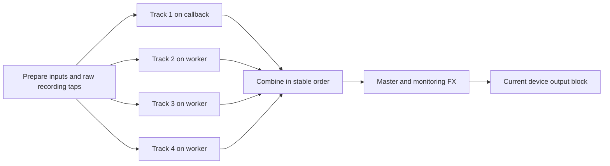

# NAM Rack

The NAM Rack is OpenStudio's free, open-source guitar and bass workspace. It hosts Neural
Amp Modeler A1 and A2 pedal, amp, or full-rig captures inside the DAW, surrounds them
with native pedals and studio effects, loads cabinet impulse responses, saves
complete tones, and optionally connects to TONE3000.

OpenStudio does not charge to unlock the rack or its built-in effects. NAM and
OpenStudio are open source. Third-party captures and impulse responses still
retain their creators' licenses.

## Sign in and browse

Open the capture or IR library from the Amp, Pedal NAM, or Cab signal block.
Choose **Browse** beside the T3K logo or **Connect TONE3000**. A signed-out user
sees the community introduction; **Continue** opens TONE3000 in the default
browser to sign in and select a tone. The returned tone opens its capture details in the
rack. Choose the exact capture, then **Audition** or **Use**.
Connecting does not block the rest of the rack. A release build includes the
publisher's OAuth client configuration; musicians do **not** need an API key.
A missing publisher configuration is a release/build problem, not an end-user
setup step. Local captures, cabinet IR files and installed tones work offline.

Authorization is stored for the current OS user and computer and refreshed when
possible. Relaunching or opening another rack window should not require a new
login. Each new computer signs in once. Revoked credentials or denied secure-store
access can require reconnection; errors remain visible beside Connect.

Typing starts a search after 400 ms; Enter submits immediately. Changing the
query, architecture, source or sort cancels the previous search and prevents its
results from replacing the latest request. A spinner also appears while updating
an already populated list. Creator, license, instrument and character filters
apply to the loaded results. Relevance, newest and other provider-supported
sorts are sent to TONE3000; local sort choices are labelled.

### Community presentation (development checkout, October 8, 2026)

The library uses TONE3000's supplied full logo at entry points and in its header,
with the compact T3K mark after **Browse** for the persistent button and on loaded
tone attribution. Results and details show artwork, title, gear, NAM/IR format,
creator username and avatar when supplied. Details also expose the creator's
description and capture selector. The header shows the connected username and
avatar, with initials when the image is unavailable. A circle such as **AD** is
the signed-in account's initials. The button retains **Browse TONE3000** as its
accessible name. The header and library controls adapt to available width and
height so the scrolling tone list has more room at compact window sizes.
In compact library views, open **Selected · details & actions** for the selected
tone and capture controls; loading captures opens it automatically. The library
tabs scroll horizontally in narrow hosts, keeping all six views available.

**Favorites**, **Created**, and **Downloaded** are the connected account's
TONE3000 collections. **Installed** and **Local Favorites** refer to this
computer's library; the result star adds a local favorite. Account endpoints
provide their own order; other sort choices apply to loaded results. Gear,
format and architecture compatibility are checked locally where the account
endpoint does not support those filters. Account results are cleared on sign-out
or session change.

New installations retain the tone artwork URL and attribution in their local
manifest, so loaded signal blocks can display the source mark after restarting.
Older manifests without artwork use a placeholder. Click the loaded tone's
attribution to reopen its details. The compact library retains these details
and the capture selector in its scrolling panel.

The [TONE3000 design requirements](https://www.tone3000.com/api#design-requirements)
require branding, creator attribution and the signed-in avatar and username on
tone lists, while allowing layouts to match the host application. OpenStudio
uses their [official logo assets](https://www.tone3000.com/TONE3000%20Logos.zip),
including the compact T3K mark for small controls.
This guide describes the development checkout, not a shipped release or partner
approval. Local browser checks use deterministic fixtures; a real authenticated
Select round trip and provider review remain release acceptance checks.

## Musician workflow

1. Add the NAM Rack to a track, choose the live instrument input, and select the
   Guitar or Bass profile.
2. Set the device buffer and input trim, then tune.
3. Load a local A1/A2 capture or connect TONE3000. When a tone pack contains
   more than one capture, open its capture list and choose the exact child
   before auditioning or using it.
4. If the capture is amp-only, load a cabinet IR. A full-rig capture that
   already contains a cabinet bypasses the separate cabinet stage.
5. Shape the front end with the native pedalboard and finish the sound with EQ,
   modulation, delay, and reverb.
6. Save the complete rack as a tone or project state.

### Multi-capture packs and audition

TONE3000 results are presented as tone packs rather than duplicating one card
per child model. A pack reports its declared capture count; opening **View
Captures** hydrates the available children and shows each name, NAM
architecture, and topology such as **RAW / AMP ONLY**, **CAB EMBEDDED**,
**PEDAL**, **PREAMP**, or **STUDIO**.

For a pack with more than one capture, the pack row is not an implicit model
choice. The user must select a concrete child before **Audition** or **Use** is
enabled. A selection is identified by tone ID plus model ID; URL-only children
use a normalized URL identity so two captures without numeric IDs do not
collapse together. The `tone:0` pack sentinel is never treated as a real child
capture.

The lifecycle is deliberately explicit:

1. Selecting a child updates only the pending UI selection; it does not change
   the audible rack.
2. **Audition** prepares/downloads that child as needed and temporarily
   publishes it to the target slot. Auditioning another child supersedes the
   first preview.
3. **Stop** or Cancel restores the complete baseline that existed before the
   preview, including capture, cabinet state, and relevant mix/power values.
4. **Use** commits that exact child and its durable source metadata. It can then
   be recalled, pinned in filtered library views, and recovered after restart.
5. Opening the capture selector and using another child replaces the current
   capture. Amp power bypasses/re-enables an Amp capture without losing it, and
   Amp **Unload** clears that slot. Pedal NAM uses Pedal Mix for bypass; removing
   the broader Pedal module also clears its pre-Amp module settings.
6. A CAB EMBEDDED/full-rig child bypasses the external Cab stage without
   deleting the chosen IR. Returning to an amp-only child restores the external
   cabinet workflow.

Model preparation, stale-request rejection, and rollback are deterministic
test contracts. The user interface also exposes the child list and actions to
keyboard/assistive navigation. Absence of audible clicks, dropouts, or
real-interface crackle remains `not_asserted` until the exact release artifact
is auditioned at small and normal buffers.

The current audible route is:

```text
Input trim
  -> Gate detector key (sidechain only)
  -> Compressor
  -> Octaver Fuzz
  -> optional Fuzz (independent switch)
  -> EQ Boost / pre-EQ
  -> Precision Drive
  -> Distortion
  -> optional A1/A2 Pedal NAM capture
  -> A1/A2 Amp or Full-Rig NAM capture
  -> Global Gate gain
  -> Cabinet IR
  -> Cabinet Space (early Room / optional Doubler)
  -> reorderable EQ / modulation / delay / reverb
  -> Output trim
  -> final stereo-linked finite/level safety guard
  -> meters
```

The tuner observes the input without becoming part of the audible chain.
Pedal NAM is an optional serial pre-amp slot. When loaded, its calibrated wet
path and the native pedalboard feed the Amp/Full-Rig NAM slot; a partial Pedal
mix preserves the single-input dry/wet balance before a following mono Amp NAM.
A pedal-only capture is not a complete amp/cab tone by itself; it normally needs
a following Amp/Full-Rig and, for an amp-only capture, a cabinet IR.
The former global live Transpose, Chaos mode, Glitch, and Laser product
controls are retired. The new Cabinet Space Doubler is a separate post-cab
presentation effect, not a revival of the retired global control. Legacy Laser
fields are ignored and pruned when old projects are restored; they are not
exposed or processed by the active rack.

### Guitar/Bass instrument-profile contract

Instrument Profile is a non-destructive voicing selector. It never replaces or
unloads a NAM capture or cabinet IR. Its hidden DSP mapping changes the
frequency-, tracking-, headroom-, and low-end-sensitive behavior that should
follow the instrument. A direct user switch translates only the recognized
Guitar/Bass Gate starting pair (`-80/-65 dB`). Cab filter power and cutoff are
always explicit user choices and never change as a hidden profile side effect;
preset recall retains their exact saved values.

The current profile-aware components are:

- EQ Boost keeps its eight stable preset/automation IDs, but Guitar presents
  `120/250/500/1k/2.5k/5k/8k/12k` and Bass presents
  `50/120/250/500/800/1.6k/4.5k/10k`.
- The stereo poly Octaver changes its analysis and pitch-tracking profile so
  B0/E1 bass fundamentals remain supported without weakening Guitar tracking.
- Precision Drive, Distortion, the Amp input wrapper, and the Amp tone stack
  move their hidden low-frequency split/weighting and tone centres downward
  for Bass. Precision Drive also replaces most of its Attack-selected wet low
  band with a unity clean low band, and the shared native-drive island
  reserves 3 dB more nonlinear headroom with reciprocal output recovery. Its
  Bright mapping retains the full control travel but uses a lower Bass maximum
  cutoff to constrain post-clip fizz. The visible Drive, Attack, Bright, Voice,
  Bass, Mid, Treble, and Presence values stay untouched.
- The post-cab Graphic EQ retains its fixed nine labels; in Bass mode its 65 Hz
  band becomes a low shelf instead of a narrow peaking band.
- Bass modulation keeps a unity direct path while the existing wet-path high
  pass prevents the modulated branch from replacing the fundamental.
- Bass Delay keeps unity direct audio and applies a higher high-pass only to
  repeats/feedback. Time, feedback, mix, modulation, ducking, mode, ping-pong,
  and sync remain the user's values.
- Plate, Hall, and Room Reverb shorten only the low-band decay ratio in Bass
  mode. The visible decay and low-cut values remain exact. Studio retains its
  legacy mapping for old-preset compatibility.

Compressor, the loaded Cabinet/IR asset, Cabinet Space, visible
trims, and tuner remain profile-invariant. The interface calibration reference
also remains hardware truth: Bass headroom is applied only inside the native
drive operating domain and must never rewrite `calibrationReferenceDbu`.
Compressor detector HPF and non-default Graphic-EQ/reverb cutoffs remain explicit
creative choices. The tuner already covers 27.5-1320 Hz, so it needs no
mode-dependent range change.

The global Gate is keyed from the clean calibrated input and applies its linked
gain after the native pedals and NAM Pedal/Amp slots, before Cabinet/IR. This
allows it to attenuate noise emitted or amplified by nonlinear models rather
than merely silencing their input. Gate release remains an explicit control.

Library filtering follows the profile only as a discovery aid. Untagged/shared
captures remain visible, an explicitly opposite-tagged active capture remains
loaded and is pinned in the list, and changing profile never downloads, swaps,
or unloads an asset. A factory-template label is cleared if that template no
longer matches the chosen profile; the resulting control state remains intact.

### Tuner behavior

Opening the tuner explicitly subscribes that NAM Rack to its dry hardware-input
route; record arm and input monitoring are not required. Multiple rack windows
use independent subscriber IDs, so closing one window cannot disable another.
The most recently opened tuner owns the analysis route until it closes, then
the prior subscriber resumes. A master-rack tuner explicitly observes global
hardware Input 1.

The audio callback only selects the strongest routed channel and copies it into
a preallocated lock-free FIFO. A low-priority worker applies anti-aliased
downsampling, full-range MPM/NSDF pitch detection, parabolic period refinement,
and a temporal tracker. This keeps analysis out of the audible path and adds no
audio latency.

The supported range is 27.5-1320 Hz, covering B0/E1 bass fundamentals through
upper guitar. Estimates are converted to absolute musical cents, median
filtered, and confidence-weighted before display. Three consistent frames
acquire a note, with the first pick-heavy window deliberately deweighted.
Large note or octave changes require repeated agreement, and note-name
hysteresis prevents boundary flicker. A missing estimate enters `Holding`: the
last average remains unchanged for about 450 ms, then fades and clears around
1.2 seconds after genuinely missing pitch. Closing the final subscribed tuner
disables the worker-side analysis. The worker discards stale queued audio
rather than letting CPU pressure turn into seconds of display lag.

## Why A2 matters

NAM A2 is the current Neural Amp Modeler architecture. TONE3000 and the NAM
project describe it as a more accurate and more efficient successor while
keeping the model format and inference ecosystem open. OpenStudio loads both A1
and A2 so existing libraries remain useful while new A2 captures can take
advantage of the newer architecture.

That gives OpenStudio a credible free alternative in the same creative category
as AmpliTube, Guitar Rig, and Neural DSP plug-ins: a playable amp-capture rig
with pedals, cabinets, effects, presets, and DAW recall. It is not an objective
claim that every capture beats every commercial product. Capture quality,
interface calibration, cabinet choice, and the player still determine the
result, and subjective comparison remains a musician's decision.

## Architecture

The main implementation lives in:

- `Source/BuiltInEffects2.h/.cpp` — rack DSP, A1/A2 model preparation and
  processing, cabinet convolution, effects, transitions, calibration, state,
  latency, and diagnostics.
- `Source/NAMCabPresentation.h/.cpp` — bounded post-cab early-room and
  doubler presentation, transient protection, mono compatibility, and spatial
  diagnostics.
- `Source/NAMPolyOctaver.h/.cpp` — independent-channel ERB phase-scaling
  octave voices used by the current stereo/polyphonic Octaver.
- `Source/TunerPitchTracker.h/.cpp` — real-time-safe input tap, background
  MPM/NSDF detector, sustained-note averaging, and hold/release state.
- `Source/MainComponent.cpp` — native bridge, TONE3000 OAuth/search/download,
  local library, and secure token persistence.
- `frontend/src/components/NAMRackPanel.tsx` — rack application state and user
  workflow.
- `frontend/src/components/NAMRackDesignPort.tsx` — hardware-style stage UI.
- `frontend/src/components/NAMExplorer.tsx` — local/TONE3000 browsing,
  preview, installation, and recovery.
- `frontend/src/services/NativeBridge.ts` — typed native API and deterministic
  development mocks.

### Real-time contract

- Model parsing, file I/O, allocation, and convolution preparation occur away
  from the audio callback.
- Prepared models and IRs are published atomically and retired after readers
  have left the previous graph.
- The callback uses preallocated buffers and bounded work.
- Sample-rate conversion is explicit around NAM models whose expected rate
  differs from the host.
- Fixed latency is reported to the host, with aligned dry paths during bypass
  and crossfade transitions.
- Precision Drive and Distortion share the selected 2x/4x/8x nonlinear rate
  island. It contributes one host-reported latency for every pedal power
  combination; neither stage performs nested resampling.
- No timing result from one machine is marketed as a universal CPU claim.

The current resampler indexes each 48-tap window as at most two contiguous
spans of its 128-sample history ring. The kernel, phase scheduler, zero padding
and ordered double-precision accumulation remain unchanged; this removes
repeated indexing work rather than selecting a different resampling algorithm.
Delay also returns before resolving its macro controls when disabled with no
remaining tail. Off-state edits are applied on engagement, while existing tails
still drain through the normal processing path. Exact reference/lifecycle
contracts gate these optimizations separately from wall-clock timing; see
[testing](testing.md#octaver-fuzz-checks). They do not establish live-interface
stability or an audible improvement.

### Input routing and stereo NAM contract

The DAW track route is the sole input-topology authority. A one-channel route
uses the mono NAM path. A route with two or more channels uses the stereo path
automatically when every loaded NAM slot has either two prepared 1x1 lanes or
a native 2x2 graph; if a loaded slot cannot support stereo, the Rack safely
falls back to mono. Empty slots do not prevent the remaining stereo effects
from processing a stereo track.

The standard NAM capture used by the public ecosystem is normally a stateful
1-input/1-output processor. For stereo processing, its atomically published
owner contains two independently constructed and prepared `nam::DSP` graphs.
Left and right have separate model,
resampler, FIFO, dry-delay, calibration, fault, output-history, and NAM Slim
activation state. The callback evaluates the lanes sequentially with shared
preallocated scratch memory, but stages both results until the pair completes;
a runtime fault in either graph therefore publishes latency-matched dry for both
channels in that same callback, never one wet lane beside one dry lane. The Rack
never clocks one DSP object twice. A native 2x2 NAM model, if one is loaded, runs
once and does not receive a duplicate wrapper graph. Cabinet convolution
continues to process the resulting stereo lanes.

Changing among routing modes uses an 8 ms fade-out, a muted 24 ms plus reported
latency state-prime interval, and a 12 ms fade-in. The graph mode changes only at
zero gain, and the envelope is before post effects so existing delay/reverb
tails remain continuous. This avoids exposing a cold or stale inactive lane and
does not allocate, lock, reset a graph, or perform I/O on the audio callback.

Both 1x1 lanes are constructed off the callback. A failed replacement cannot
disturb an already active pair. On a first load, if only the optional right graph
cannot be constructed or prepared, the ready primary graph remains available
for mono routing. Parallel lanes add no second latency contribution, but stereo
processing is expected to approach twice the NAM inference cost. Mono routing
processes only the primary graph.

There is no Rack-level Mono/Stereo preference. The retired `inputMode` key is
absent from the public schema and is ignored and pruned from legacy project,
preset, A/B, baseline, portable-state, and direct-setter paths. Physical input
selection and track channel width remain DAW responsibilities. Diagnostics
publish the automatic and effective mode so the UI can explain transitions and
pause the mono-only Doubler without introducing another user setting. Loading a
compatible model or changing the DAW track width activates the corresponding
route through the same muted handoff described above.

### Meter topology contract

The input meter measures the routed signal before Input Trim. A configured mono
source renders one full-width lane; a configured stereo source renders genuine
L/R lanes. This presentation follows `routedInputChannelCount`, not the
effective NAM graph, so a stereo route remains visibly stereo if a mono-only
capture forces an internal fallback. Returning to mono clears the hidden right
peak and hold, and the numeric level and clip indication use only visible lanes.

The output meter always renders independent L/R peaks from the final Rack output
boundary. Linked input/output peak values remain compatibility fallbacks for an
older native build; the frontend never invents stereo values from a linked peak.

**Output peaks reduced recently** means the rack's final peak protection
softened loud peaks. Lower **Output** if you want less of that compression.
The amber message follows newly observed activity and becomes neutral history
after three seconds without another event. Opening a rack with an existing
counter shows **Earlier output peaks were reduced**, not a current warning.
This differs from **Overload** (missed processing work) and the separate
emergency safety mute. The message wraps and is keyboard accessible instead
of hiding its explanation behind an ellipsis.

Low-buffer timing results are machine/build-specific `diagnostic_only`
evidence, not proof of ASIO stability. Driver safety and subjective stereo
presentation still require testing on the target system and exact release build.

### Cabinet/IR parameter ownership

NAM Core supplies the neural model renderer; it does not expose cabinet knobs.
The official NAM plugin wrapper adds an IR file slot, IR enable, and clear action,
but no mic-position, mic-distance, blend, bloom, pan, room, or doubler parameters.
Its current public parameter enum is documented in the upstream
[`NeuralAmpModeler.h`](https://github.com/sdatkinson/NeuralAmpModelerPlugin/blob/main/NeuralAmpModeler/NeuralAmpModeler.h).

OpenStudio owns the complete external cabinet stage around its IR loader. All
tones now use Cab V3, whose signal path is deliberately literal:

- **Cab Power** enables the external convolution slot; **Unload** clears the IR
  resource, while Reset remains a separate parameter operation.
- **Level** is post-IR gain. Cab has no additional HPF/LPF; the post-cab
  Graphic EQ is the one visible owner of tone-filter cutoffs.
- **Stereo IR** chooses native stereo-IR processing. Its off state is dual mono:
  one mono IR response is applied independently to left and right without
  cross-channel coloration.
- **Phase** is polarity inversion.
- **Pan** uses bounded channel attenuation. Room and Doubler belong to the
  separate Cabinet Space stage.
- **Direct** is a Bass-only, latency-aligned clean-DI blend. It is captured after
  input calibration and compression, before octave/drive/NAM/Amp/Cab, and mixed
  after the processed rack path. The global Gate still controls it. It remains
  available for amp-only, full-rig, and external-IR workflows.

The former **Tone Edge**, **Tone Damp**, **Shaper Blend**, and **Low Bloom**
controls were OpenStudio synthetic shapers, not NAM parameters and not physical
mic controls. The current Cab neither exposes nor processes them. Every old
project, preset, Compare snapshot, and portable state migrates to this same
IR-only implementation. Active historical Cab HPF/LPF filters are merged once
into the visible Graphic EQ. When EQ was enabled, the stronger active cutoff
bounds win and its band gains and level remain intact. When EQ was bypassed,
it starts flat before being enabled to carry the Cab filters, so dormant EQ
settings do not become audible. A bypassed Cab leaves EQ unchanged. The old
Cab filter state is then neutralized. Stereo/direct routing is preserved and the
retired synthetic shaper values are discarded. This intentionally moves both
guitar and bass tones onto one cabinet engine.

The selected IR remains intentionally tonal. IR import uses uniform gain
normalisation and trailing-silence trim, which can change level and IR duration
but do not add a separate frequency-dependent cabinet curve. A dark, phasey, or
already-processed IR can therefore still sound dark or phasey even with every
OpenStudio Cab V3 operation neutral.

### Cabinet Space presentation contract

Cabinet Space is a fixed post-cab presentation stage, before the reorderable EQ,
modulation, Delay, and Reverb. It also runs for captures with an embedded cab;
placing it inside the external IR function would incorrectly skip those rigs.
Room accepts new input only from an engaged external Cab/IR or an audible,
engaged Amp/Full-Rig capture with an embedded cabinet. With an amp-only capture
and the external Cab off, or with both Amp and Cab off, Room may remain armed
and its existing history may drain over unity dry, but raw DI cannot enter a new
tail; the UI reports **No cab source**.

Room Amount/Width feed a deterministic asymmetric 2x2 early-reflection field.
Doubler Mix/Spread and its 3-20 ms Delay (4.5 ms by default) add two independently
drifting short-delay voices around the selected time. Doubler generates stereo
only for a routed mono source; a true-stereo source pauses it with an explanation
without rewriting its saved enable, mix, delay, or spread. The close cab signal
remains an unattenuated centre anchor and the generated side is mixed as `+S/-S`,
so summing the output to mono cancels the added side rather than comb-filtering
the direct tone.

The design follows the practical contracts exposed by current guitar products:
mono can become stereo at a component boundary, while true stereo input remains
stereo; a doubler uses millisecond-scale spread; and cabinet presentation is
separate from the late Delay/Reverb. It also follows the DAFx open-source
widener findings that low frequencies should remain more centred and that a
decorrelated path needs transient handling. Accordingly, two cascaded side
high-passes keep bass anchored, and a shared onset envelope ducks only the wet
Room/Doubler fields (up to about 3/6 dB respectively) while leaving the direct
pick attack untouched.

The processor uses preallocated feed-forward early/Doubler paths plus a bounded,
damped four-line late-room network, with no runtime allocation, locks, logging,
or I/O. Its deterministic gates cover exact bypass, reset/partition equivalence,
mono-fold cancellation, mono-to-stereo generation, the 3.1 ms first reflection,
44.1/48/96 kHz operation, wet-only low-frequency side/mid balance, prefilled
automation, transient recovery, NaN/Inf recovery, bounded tail, and 8-sample
component timing. Wall-clock scheduler outliers remain diagnostic-only.
Perceived externalisation, naturalness, and similarity to a named product are
still `not_asserted` until a level-matched musician audition.

Cabinet Space is controlled independently from the external Cab/IR switch. Its
compact Signal Chain entry owns Room and Doubler access; the Cab faceplate only
links users to that separate stage. Room and Doubler retain independent power
and stored controls, so either may be bypassed while the other remains audible,
and Width/Spread shape only their corresponding active field.

### Native pre-amp pedal level contract

Precision Drive and Distortion use one current pre-release implementation. The
Guitar profile uses a `+12 dBu` native-pedal operating reference before the Amp
NAM stage. If the interface/rack calibration reference is `R dBu`, the shared
nonlinear island receives `R - 12 dB` before the selected shared 2x/4x/8x
processing and applies the exact reciprocal gain afterward. Bass subtracts a
further 3 dB only inside this nonlinear island, with the matching reciprocal
recovery. This keeps the represented analog pedal level stable when the
interface reference changes, reserves headroom for hotter bass pickups without
changing linear loudness, and avoids applying the conversion twice when both
pedals are stacked.

Precision Drive is a full-wet overdrive circuit, not an EQ-only boost. Attack
sets a frequency-selective feedback split: low frequencies retain the unity path
while upper lows and mids receive Drive-dependent gain into an asymmetric
nonlinear cell. Bright shapes the post-cell bandwidth, a DC blocker removes the
intentional asymmetry's offset, and Volume is an exact post-circuit gain. The
current default Volume is `+9 dB`, giving the pedal enough output to push a clean
Amp NAM; a saved explicit nonzero Volume remains the user's value.

Precision Gate is a local, input-keyed control whose Off position is exact
unity. Its stereo-linked detector reads the untouched calibrated island input,
while its gain is applied after the complete Precision circuit and Volume but
before Distortion. Threshold, hold, detector release, and smooth closing follow
the selected amount; reopening is fast. The nonlinear circuit remains warm
during closure, and linking the envelope never mixes audio between channels.

Distortion is a clean-room modern-heavy design informed by Empress's published
Heavy/Heavy Menace behavior, not a circuit clone. It distributes gain across
three zero-centred nonlinear cells with filtering between cells, then feeds a
stateful diode stage. `Weight` is a pre-distortion high-pass macro (`Tight` to
`Thick`), Tone controls interstage/presence voicing, and Heavy, Extreme, and
Crunch select distinct gain-density ranges. Mix crossfades the latency-aligned
clean stage input against the complete distorted branch. A fixed `-2.5 dB`
internal calibration keeps ordinary high-gain transients below the rack's
emergency knee; Level is applied exactly once after the complete topology.
`Dist Gate` is a dedicated stereo-linked idle-noise gate. Its detector reads
the untouched calibrated drive-island input before Precision Drive, while its
gain is applied after the complete Distortion circuit, Mix, and Level. This
input-keyed/post-distortion placement leaves the approved open tone unchanged
while suppressing small-signal noise buildup when the input drops below the
selected threshold. The current `0.22` default uses 6 dB hysteresis, a 35 ms
hold, a fast reopen, and a smooth close; `0` is the exact-unity bypass. The
nonlinear state remains warm during closure, and the linked envelope applies
the same gain to both channels without mixing audio between them.
The public design references are Empress's
[Heavy Menace overview](https://empresseffects.com/products/heavy-menace) and
[Heavy/Heavy Menace design history](https://empresseffects.com/blogs/empress-blog/the-heavy-menace-celebrating-10-years-of-heavy).

The shared island uses one latency-aligned power transition instead of
multiplying nested pedal fades. Mid-transition reversals remain continuous, and
reaching exact bypass performs bounded fixed-state cleanup. The shared IIR
oversampler is drained incrementally with zero input across ordinary bypass
callbacks rather than performing a capacity-sized reset in one low-buffer
callback. The path has independent left/right state and performs no runtime
allocation, lock, I/O, nested resampling, or lookahead.

The serialized `namEffectsDspVersion` field is an internal migration schema,
not a user preference or a supported legacy-engine selector. Because NAM Rack
has not shipped, every recognized old or missing marker is translated to the
one current implementation during binary, project, tone, and portable-state
restore. For pre-current presets only, the former default Precision Volume of
`0 dB` maps to the current `+9 dB` default; explicit nonzero controls and
model/IR resources are preserved. No old pedal DSP remains selectable or
runnable after restore.

### Other pre-NAM pedal contracts

The current Compressor exposes `Comp`, explicit `Attack` (0.1-50 ms), explicit
`Release` (50-1000 ms), a neutral-at-centre 500 Hz `Tone` tilt, an `Intensity`
switch, true parallel `Mix`, signed `Level` (-18 to +18 dB), and detector HPF
choices Off/80/240 Hz.
`Comp` moves the threshold from -6 to -44 dB and the knee from 12 to 2 dB;
`Intensity` selects an 8:1 or 16:1 ratio. Its calibrated gain-reduction meter is
shown on the pedal. The
range and interaction model deliberately cover the useful overlap documented
by Dyna Comp, Cali76, Empress Compressor MKII, and Keeley Compressor Plus,
without claiming to copy their proprietary OTA/FET circuits or synthesising
their noise.

The Compressor first builds its complete parallel signal and then applies the
signed Level control to that complete stage:

```text
stage = (1 - Mix) * dry + Mix * compressed
output = dBToGain(Output) * stage
```

The child compressor therefore has no hidden positive makeup contribution.
After Compressor bypass has drained its 25 ms transition, its detector,
RMS envelope, filters, and lookahead state are reset before the next engage.
The stable Level automation/state ID remains `compressorVolumeDb`. The retired
pre-release `Detail` macro is accepted only by migration: it is translated once
to its exact former effective attack/release times, removed, and never selects
another compressor implementation.

The Rack Graphic EQ is nine bands at 65/125/250/500 Hz and 1/2/4/8/16 kHz,
with +/-12 dB per band. Its HPF provides exact **Off** plus logarithmic
20-500 Hz travel; its LPF provides logarithmic 3-20 kHz travel plus clockwise
**Off**. Mirrored 6% endpoint detents, double-click-to-Off, value formatting,
automation, MIDI learn, and state all use the same mapping. Each filter retains
its last active cutoff while Off.

The processing order is HPF, nine bands, LPF, then the separate smoothed +/-12 dB
Level control. Both edge filters are stereo 12 dB/oct Butterworth responses with
smoothed coefficients and short Off/On transitions. The upper 16 kHz band is a
high shelf rather than a near-Nyquist bell. Flat/Off and whole-module bypass are
transparent, filter state remains warm while bypassed, and the minimum-phase
path adds no latency, saturation, hidden makeup, or modelled hiss. Migration
defaults the filters to Off and Level to 0 dB while preserving established band
IDs and private last-active cutoffs.

The former dedicated Tape Echo pedal is retired in NAM effects DSP version 17.
Its six `tapeEcho*` parameters are removed from processing, automation, schema,
and UI state. Legacy values are pruned without being mapped onto the post-FX
Delay, so recalling an older tone cannot overwrite that Delay's saved settings.
The existing post-FX Delay remains available and retains its Tape mode.

Gate topology is unchanged. The octave section of `Octaver Fuzz` uses independent L/R
instances of the MIT Terrarium-derived ERB-PS2 topology, with fixed 6:1
multirate processing, 80 complex bands at `Fs/6`, fast phase scaling, and
polyphase reconstruction. Six-sample scheduling state is retained across host
callbacks, so arbitrary partitions are sample-exact. The production callback
performs no allocation, locking, I/O, coefficient design, or dynamic growth.

Deterministic fixtures cover exact silence/bypass, L-only isolation, identical
stereo parity, reset and fixed-versus-uneven callback partitions, NaN/Inf
recovery, 110/220/440/880 Hz target generation, at least 70 dB stop-band
rejection, and 44.1/48/96 kHz operation. All reset/partition/leak/parity errors
were exactly zero in the final Release run. The optimized isolated 48 kHz /
8-sample both-voice path measured p50 `2.9 us`, p99 `8.0 us`, and zero deadline
misses on the test machine. These are correctness and machine-specific timing
checks only: perceived chord tracking, pick transients, voicing, and
product-reference quality remain `not_asserted` until musician audition.

### Octaver Fuzz (October 12, 2026 development checkout)

The 156-pixel olive pedal replaces the former 120-pixel enclosure. Its upper
row is Down/Up/Direct and its lower row is Fuzz/Tone/Level. The header provides
a Vintage/Sustain/Gated voice selector; separate Octave and Fuzz footswitches
and LEDs indicate the two active sections. The PRE row is 784 pixels wide,
centred on the existing rack artboard. The October 23 layout integrates a
dedicated Clean knob beside Voice, with a visible percentage. Enter/right-click
opens exact entry; Escape cancels, double-click resets, and keyboard adjustment
and Undo share the normal parameter path. Device Controls retains the same
parameter. A registered SVG silkscreen overlays the unchanged olive body;
stationary artwork and interactive controls have separate, measured bounds.

The October 15 follow-up shortens the faceplate and compact product name to
**Octaver Fuzz**. Stereo/polyphonic operation is unchanged.

Fuzz runs after the stereo octave/direct mix and before PRE EQ. With Octave
off it processes the unshifted signal. Vintage uses two asymmetric clipping
cells with envelope-dependent bias and sag; Sustain uses two symmetric cells
and a complementary scooped tone branch. Its bright branch retains a 15%
low-frequency floor to avoid the measured bass/clean phase opposition of the
original pure high-pass. Gated uses biased asymmetric cells and a smoothed
channel-local gate. These are original digital voices, not
circuit-qualified replicas. Guitar/Bass changes internal filter centres without
changing the saved controls.

The six stable additive parameters are `fuzzEnabled` (default off), `fuzzDrive`
and `fuzzTone` (0-1, default 0.5), `fuzzLevelDb` (-18 to +12 dB, default 0),
`fuzzVoice` (0 Vintage / 1 Sustain / 2 Gated), and `fuzzCleanMix` (0-1, default
0). Clean blend refers to the signal immediately before fuzz, including active
octave voices. Control changes and voice switching use 25 ms ramps. The
nonlinear cells use first-order antiderivative antialiasing with DC removal;
there is no additional oversampling island or reported integer plugin latency.
ADAA has its inherent fractional-sample filtering delay. Processing uses fixed
channel state without allocation, locks or file access in the callback.

Older states and complete preset/Compare snapshots without fuzz fields restore
fuzz off. Native/portable tone state, project state, A/B Compare and parameter
Undo retain the fields. Existing persistence and DSP version markers remain
unchanged because the controls are additive and have explicit migration defaults.
Deterministic regressions cover bypass, silence, finite output/recovery, stereo
isolation, reset, callback partitions and recall. Voice metrics are
`diagnostic_only`; perceived tone and reference-pedal similarity are
`not_asserted` until user audition.

The order protects octave tracking from fuzz: octave analysis receives the
pre-fuzz signal. Direct/Down/Up retain their original audio mix. A separate
control-derived headroom gain scales only the nonlinear input and sag:
`max(1, Direct) / max(max(1, Direct), Direct + Down + Up)`. It uses each sample's
actual 20 ms ramped mixer coefficients, so compensation does not lead or lag
knob changes. Solo voices keep their gain and quieter settings are never
boosted. The clean branch and Gated detector retain the incoming mix level.
This bounds extra excitation from mix controls; it does not separate chord
notes or remove the sum/difference tones of shared clipping.

Sustain has a fixed control-derived center-Tone makeup curve, bounded to 0-5 dB:
`(1 - abs(2*Tone - 1)) * (3 + 2*min(1, 2*Drive))`. Its gain ramps over 25 ms.
All fuzz wet voices then receive a shared 0.86 trim (about -1.31 dB), before
Clean blend and the user's Level. There is no audio-driven AGC, output
normalization or hidden limiter. The correction reduces default voice jumps;
bright/dark Tone settings retain source-dependent level differences rather
than boosting narrow transients to match full-band RMS. Level can still drive
the following NAM/drive and final rack guard harder.

Partial Clean blend mixes the immediate incoming octave sum with a filtered,
ADAA-processed signal. Its frequency-dependent phase differences can color or
thin the blend; adding a fixed dry delay alone would not match all the filters.
At 100% Clean blend and Level 0 dB, the complete incoming octave mixture is
restored. The lowest bass octave-down fundamentals also encounter the octave
stage's 18 Hz high-pass plus the fuzz's Bass 12 Hz input high-pass and 12 Hz DC
blocker. Gated intentionally attenuates quiet input. Guitar retains the original
soft gate and 1/80 ms detector, with 3/12 ms gain attack/release. Bass has a
separate 1/120 ms detector, opening at the existing Drive-dependent threshold,
closing below half that threshold after 65 ms continuously below it, and
3/30 ms gain attack/release. The 6 dB hysteresis and hold preserve decaying low
notes through envelope troughs; sub-threshold re-entry can still remain gated.
Sag keeps its independent original detector timing. Stereo channel state remains
independent. These are audition cases, not findings that a particular output
sounds wrong. Aliasing is reduced by ADAA/filtering but its audibility is not
established.

These October 15 development refinements change active fuzz voicing while
retaining all control IDs, ranges and saved values. Earlier active development
tones can sound different. Older projects without fuzz still restore it off;
exact bypass, full-clean parity, native/portable/Compare recall and callback
partition contracts are retained. There is no persistence or DSP version bump.

The product research establishes a common pedal category, not sales rankings:
[MXR Poly Blue Octave](https://www.jimdunlop.com/mxr-poly-blue-octave/) combines
polyphonic octaves and independent fuzz;
[EHX Octavix](https://www.ehx.com/products/octavix/) and
[MXR Blue Box](https://www.jimdunlop.com/mxr-blue-box-fuzz/) illustrate octave
fuzz, while [Orange Fur Coat](https://orangeamps.com/wp-content/uploads/2017/08/FUR-COAT-MANUAL-V1.pdf)
provides an independently switched octave. Classic voice references include
[Fuzz Face](https://www.jimdunlop.com/germanium-fuzz-face-mini-distortion/) and
[Big Muff](https://www.ehx.com/wp-content/uploads/2021/01/big-muff-pi-manual.pdf).
The implementation uses the published
[antiderivative antialiasing method](https://www.mdpi.com/2076-3417/10/1/20)
with an original bounded piecewise-cubic transfer and its analytic integral.

### Full-rig fuzz qualification (October 18, 2026)

The October 23 Swollen Pickle review distinguishes amplified input noise from
self-generated noise. The [manufacturer's MkIIS manual](https://www.jimdunlop.com/content/manuals/WHE401S.pdf)
describes separate intensity, filtering, mid-scoop and compression decisions.
OpenStudio's symmetric, scooped Sustain voice is the closest architectural
starting point; Vintage and Gated retain their other characters. This is not
a circuit replica. The manufacturer's [instructional demonstration](https://www.youtube.com/watch?v=patkTztLSAs)
was located, but its playback could not be inspected here; no listening or
spectral-match claim is inferred from its metadata. The manual's analog noise
specification is not comparable to our unweighted digital RMS fixture.

Vintage/Sustain excitation now follows `1.5 + 73.5 * Fuzz^4`, replacing
`5 + 70 * Fuzz^2`. This gives useful lower gain without a hidden gate or output
normalization and retains the 75x full-drive endpoint. Gated keeps its original
mapping. Moderate settings amplify less idle noise and also sustain quiet
decays less strongly; saved active development tones therefore change. The
input-keyed global Gate still needs an explicit threshold above real idle
noise, with Release chosen for the instrument. Its gain acts after the native
pedals and NAM models, before cabinet/time effects. A higher-gain stack can
remain noisy with its gate open. Neither this mapping nor a quiet synthetic
fixture qualifies the sound of a complete rig. See the current
[qualification evidence](testing.md#swollen-pickle-reference-fuzz-review-october-23-2026)
for the frozen-binary comparison and its limits.

The stack review also corrected two numerical faults downstream of Fuzz:
Distortion's antiderivative clipping cells used unstable float subtractions,
and the shared Saturator low-cut lost precision at high oversampled rates.
Stable interval evaluation and double low-cut coefficients/state retain the
same intended transfer, cutoff and filter order. They add no oversampling
stage or latency. Saved controls and state versions are unchanged; standalone
Saturator also receives the low-cut correction, including its archived signal
path, so old and corrected renders are not promised byte-identical. Native
partition and numerical-oracle checks establish consistency; listening still
qualifies the sound.

The approved development work evaluates Fuzz together with the existing Drive,
Distortion, NAM amp and cabinet, rather than treating pedal-only output as a
finished guitar tone. Capture the unmodified voicing first, qualify interface
calibration and compatibility, and make one audible refinement at a time after
reviewing the exact exports. Preserve the six existing fuzz controls and
old-state off defaults; do not add a persistence/DSP version change without
migration and project/preset/Compare round-trip coverage.

Fuzz now follows the embedded Drive's fixed +12 dBu operating convention:
the interface reference determines a smoothed input gain and reciprocal wet
recovery, while the raw clean branch remains unchanged. The default +12 dBu
reference has unity calibration gain. A calibration-only capture at that
default must not be described as an independent old-build full-rig baseline.
Equivalent physical inputs at different digital interface references are a
deterministic contract; preferred distortion and gate behavior remain listening
questions. [Testing](testing.md#octaver-fuzz-checks) describes the matrix,
pairing checks and separate two-Rack timing evidence.

Rabea Massaad's own explanations support testing several useful interactions,
not one universal pedal setting:

- In the [Bare Knuckle interview, May 2, 2018](https://www.bareknucklepickups.co.uk/news/article/talking-boot-camp-with-rabea-afro),
  he describes blending several fuzzes and octave with amp gain for different
  intensities in a stereo Victory Kraken rig.
- In the [Guitar World interview, August 23, 2022](https://www.guitarworld.com/features/rabea-massaad-neural-dsp-archetype-plugin),
  he discusses fuzz into a high-gain amp and an Octavia texture, and how amp
  Tight changes the feel. Conversational descriptions of adding an effect do
  not establish its exact signal-routing order or a published circuit model.
- In the [MusicRadar interview, September 23, 2022](https://www.musicradar.com/news/rabea-massaad-guitar-interview-neural-dsp),
  he distinguishes vintage Bender-inspired fuzz from modern ThunderClaw-inspired
  distortion, and discusses bass controls on fuzz and overdrive. This is his
  account of the original 2022 plugin, not independent verification of later
  plugin versions or OpenStudio's DSP.
- [That Pedal Show's June 2, 2023 episode and routing notes](https://www.thatpedalshow.com/TPS-videodatabase/a-hang-with-rabea-%5Bstrats,-pedalboard-update,-music-man,-neural,-real-amps,-stormzy-&-more!%5D)
  place drives/compression before the Kraken preamp, with wet effects downstream
  of its FX send and a separate dry cabinet. The notes identify fuzz/octave
  discussion at 18:50 and overdrives at 22:20; they do not supply verified knob
  values for our test matrix.

The implementation inference is to audition octave/fuzz into further gain,
including deliberately dense combinations, while preserving the clean octave
tracking path. These sources do not prescribe exact ChaosBed/Silverfox settings,
prove a circuit replica, or establish an audible pass for the current Rack.

The first bounded voicing candidate adds 12 Hz AC coupling between the two
Guitar/Vintage clipping cells, so the first cell's signal-dependent DC does not
unintentionally bias the second. Bass, Sustain and Gated keep their prior paths;
the coupling filter stays warm and Guitar/Bass changes blend its contribution
over 25 ms. Gains, clipping knees and post-tone controls stay unchanged. Capture the
calibrated +12 dBu full-chain baseline before applying this candidate, and use
the same fixtures/settings afterward. The intended circuit-state correction
and finite/partition checks do not establish an audible improvement; exact-file
audition remains pending. No new parameter or persistence/UI schema is planned.

The development implementation also caches unchanged fuzz controls so normal
callbacks do not repeatedly redesign filter coefficients. Preparing at any
sample rate invalidates that cache. Fully settled, already-bypassed fuzz returns
immediately; moving ramps and active retirement still advance in sample time.
These reduce avoidable work without changing the requested controls. The
same-controls reprepare, callback partition, bypass-transition and reset
contracts protect the state semantics. They are not proof that two complete
Racks meet an 8-frame hardware deadline; see the dated
[two-instance evidence](testing.md#octaver-fuzz-checks).

### CPU and pedal interaction contract

The working tree implements exact sample-boundary Octaver retirement,
unchanged-control Drive/Distortion coefficient caches, broader offline scenario
coverage and clearer Fuzz/preset/device-setting workflows. Tone approval and
physical two-track capacity remain separate from deterministic test passes.
[Testing](testing.md#nam-audit-october-22-2026) retains the initial audit and
their limits. The earlier standalone free-FX qualification does not certify NAM.

The reported live reproduction is two armed tracks with separate guitar and
bass inputs: **Bestest clean! with Distortion engaged**, plus a bass preset,
using the Audient ASIO driver, an 8-sample buffer and 4x Drive oversampling in
`python build.py dev --run`. The current saved Bestest already enables Precision
Drive, Amp/Cab, EQ, Room, Doubler and Reverb; its Octave is off and absent legacy
Fuzz fields restore off. Distortion therefore adds a second native drive stage.
This is not evidence that active Fuzz caused the reported crackling. Saved
presets also do not prove that no controls were changed during the live test.
The user could not identify which of two recovered bass presets was loaded;
both are included in qualification. Saved resource paths and hashes identify
the tested captures and IRs. Synthetic diagnostic inputs do not recreate the
original guitar/bass performance, and saved device settings do not establish
the effective rate or oversampling during the reported session.

| Priority | Finding | Action and acceptance |
| --- | --- | --- |
| P0 | Complete two-Rack fixtures can exceed callback deadlines with Fuzz both off and on. `success` previously described signal integrity without a separate capacity gate. | Implemented explicit preset/resource scenarios, shuffled repeated timings, full measured callbacks, p99/p99.9/max and separate capacity status/CLI gate. All 600 retained offline runs pass integrity; demanding configurations still fail capacity. Both recovered bass presets are included. The follow-up silent Audient probe confirms full-engine deadline misses at 8/16 samples and passes its bounded 128-sample measurements. Original performances, visible-app workload and audible hardware stability remain unasserted. The four-track/16-sample target below remains open; the 128-sample result does not close it. Check summed output headroom separately; see Testing for limits. |
| P0 | Actual-source probing confirmed callback-dependent Octaver re-entry after full or individual wet-voice retirement, including a profile change overlapping retirement. | Implemented exact sample-boundary retirement, preservation of the still-active voice's shared state, and settled fully bypassed profile state. Permanent tests cover 3,024 retirement, 168 profile and 216 Octaver-to-Fuzz comparisons with exact output/excitation parity; 72 frozen unaffected cases remain exact. |
| P1 | Drive/Distortion redesigned unchanged coefficients each callback; Drive also calculated retired OD808 circuit coefficients on the public Precision path. | Implemented sanitized control/profile/effective-rate caches, separate gain/calibration caching and conditional historical circuit design. Prepare/reset invalidates caches. Smoothing and compatibility code remain. Forced-redesign parity and all 129 frozen default Fuzz WAVs pass; no DSP/schema version was changed. |
| P1 | Telemetry scans, normalization calculations and disabled-stage resets add overhead. | Moved unchanged normalization work behind the existing cache check. More invasive scan/reset changes are deferred: current stage timing does not isolate their benefit, and they must preserve meters, finite/peak protection and off-state edits. Safety guards remain at audio cadence. |
| P1 | Active Fuzz computes all three voices, including at Clean 100%; Octaver processes both stereo lanes. | Measured Fuzz's incremental cost is small in the retained stage fixtures; voice suspension and mono reuse are deferred because they change warm state/re-entry semantics. Keep all voices warm and independent channel state. This is an optimization candidate, not a demonstrated cause of the reported crackle. |
| P1 | The old full-chain matrix omitted Crunch, Octave-off comparisons and partial Fuzz Clean. | Implemented 531 functional full-chain cases: all 64 discrete topologies at two settings per material plus Clean, calibration, gate and octave-presence contexts. Both recovered bass presets are separately qualified for CPU with their own resources. Alternate amp families and real bass performance listening remain open; do not treat this as every continuous combination. |
| P2 | Serial clipping and Clean-blend phase differences can obscure Fuzz character. Several gates and cumulative sub-bass filtering can alter decay. | Added Clean/gate/presence/calibration coverage and aligned nonlinear residual diagnostics with independent measurement controls. Native-level listening files remain available. Exact-artifact preference and real-bass performance remain unasserted; no new hidden normalization, delay or Fuzz voicing change was made in this follow-up. |
| P2 | Clean, Level and the scope of oversampling are easy to misunderstand. | Implemented an integrated Clean knob with exact-entry, keyboard adjustment, reset and Undo, explaining the incoming octave sum, Level and downstream order. The Drive-only oversampling label remains explicit. Preset Profile review offers a named corrected copy without changing the original or active Rack. Settings reports requested versus accepted values and stays open on substitution. |

The follow-up host audit also removes inactive instrument/IR audition clearing,
render attempts and mixing from the device callback. Active leases, release
tails and stop ramps remain eligible. Pitch scrub now advances only the actual
callback length when the prepared scratch buffer is larger. These are bounded
host corrections, not evidence that preview processing caused the reported
constant crackling. Offline wall-clock misses alone cannot distinguish DSP
work from scheduling interference; qualification must include the live ASIO
callback and retain a separate headroom check.

#### Four-track live-monitoring acceptance target

The requested target is **four armed, recording and software-monitored tracks
with full NAM Racks at 16 samples**, with **8 samples as the stretch target**.
Retain 4x native-drive oversampling and the requested tone; qualify explicit
preset/model/IR combinations on the user's machine at 44.1 and 48 kHz.
The earlier 128-sample result is a temporary measured operating point, not
acceptance of this requirement or evidence that a lower buffer is impossible.
The expanded silent live probe supports recording and larger track counts,
but still excludes visible editors and physical instrument signals.

At 44.1 kHz, the complete callback has 362.8 microseconds at 16 samples and
181.4 microseconds at 8. The former serial track loop could not use additional
cores to shorten independent Rack processing. In the initial four-track Debug
live baseline, mean engine time was 441.7 microseconds, already longer than
the 16-sample period. Parallel execution reduced the mean to about 207
microseconds in the paired preliminary run; this average improvement does not
pass the deadline requirement. Retained results and their exact scope belong
in [Testing](testing.md#multicore-nam-live-qualification-october-23-2026).

**Implementation status: implemented in the development checkout; capacity
qualification remains open.** `RealtimeTrackExecutor` uses persistent helpers,
with an automatic count of physical CPU cores minus one (bounded to 0-127).
The device callback also claims available jobs. There is no four-track cap or
fixed thread per track; prepared jobs can outnumber helpers. On the inspected
12-core machine, automatic mode creates 11 helpers. This is a scheduling
policy, not a promise that 12 complete Racks meet a particular deadline.

The initial path admits isolated audio tracks with a nonempty,
native-NAM-only FX graph, without ARA, incoming or outgoing sends, or
sidechains. At least two eligible tracks and an available helper are required.
MIDI/instrument tracks, hosted plugins, other native FX, and even bypassed
non-NAM processors keep their own tracks on the callback's serial path.
Unrelated ineligible tracks do not disable parallel processing for independent
NAM tracks. Connected tracks retain the existing dependency order. Eligibility
is checked against the actual processor graph generation again at job entry.
A concurrent graph edit can reject a job; effects are never removed or
substituted to make a track eligible. With fewer than two eligible tracks or
no helpers, the whole graph retains serial execution.

Input/playback preparation and raw recording taps stay on the callback.
Prepared per-track audio/MIDI storage separates concurrent DSP. Each Rack
retains its sequential effect order. After the isolated NAM batch, the callback
processes other tracks serially and combines every completed output in the
existing dependency/summation order before master/monitoring processing. Work uses the **same
device block**, with **zero added buffering samples**. No smaller model,
automatic quality reduction, lower oversampling or extra monitoring block is
introduced. Windows helpers register for MMCSS individually. Event sleep is
the default; a bounded, opt-in polling interval is available to the diagnostic
probe for controlled wakeup comparisons, not as a user tone setting. The probe
also accepts a bounded recovery grace after the nominal collection deadline;
the app default remains zero, no extra audio buffer is added, and crossing the
nominal deadline still fails capacity. See Testing for the diagnostic flags.

The engine pins the routing snapshot before publishing work and retains it
until every worker has stopped touching its jobs. The callback's collection
deadline includes a small final-mixing reserve, not a guarantee for arbitrary
remaining serial/master work; the outer callback meter still covers all of it.
The collection deadline does not interrupt native DSP
already running, including a job claimed by the callback itself. Unclaimed
jobs can be cancelled atomically. Completed lanes can still be mixed in order;
unfinished lanes produce no late output in a later block. If workers remain
active, every processor queued in that old batch stays quarantined until
ownership drains, including already-completed lanes. Unowned tracks continue
serial processing, sends, sidechains, recording and mixing in the existing
dependency order; no new parallel batch starts while the old one remains.
Raw armed-track recording for quarantined NAM lanes continues through a
separate callback-owned tap, without touching their processor buffers. That
tap retains incoming sends from the current routing snapshot, including a
send added after the old isolated batch was dispatched. A new route from a
quarantined source still receives silence during that overload;
unrelated existing routes retain their normal signal path. Stop/reprepare, offline
render and teardown drain workers off the audio thread. These containment
rules prevent unsafe buffer reuse; a cancelled, rejected or quarantined job
still fails capacity and can interrupt monitoring.

The routing audit also corrected stopped-transport live monitoring: hardware
input now adds to an existing incoming-send mixture instead of overwriting
it. Release contracts verify stopped/playing Float32 and Hybrid64 routing,
pending-batch recording and actual PDC delay; these functional passes do not
qualify a low-buffer monitoring deadline.

NAM Rack shows **Overload** and offers **Buffer** when recent worker failures
occur, even if the outer callback meter is low. Audio Settings reports the
same condition. Diagnostics retain deadline, rejected/cancelled job and
quarantine counts separately; they are overlapping evidence, not counts to
sum. A single recent worker failure warrants a warning, which clears after
ten seconds of callback progress without another failure.



The feasibility gate is **serial preparation + dispatch/completion overhead +
longest dependent processing path + final mixing/master work < device period**,
with headroom for scheduling variation. Four workers do not divide every cost
by four. Existing single-Rack wall-time outliers also require investigation;
they do not yet distinguish intrinsic DSP cost from thread descheduling.
[Independent paths and critical paths](https://help.ableton.com/hc/en-us/articles/209067649-Multi-core-performance-in-Ableton-Live-FAQ)
explain the scheduling model, not a performance guarantee for OpenStudio.

#### Regression and remaining acceptance gates

The ownership rules above are maintenance invariants, not unfinished architecture.
Jobs follow `Idle -> Ready -> Running -> Done -> Idle`; completion must cover
processor access and scoped-guard teardown before storage is reused. Publish
the snapshot lease before dispatch, retain ownership through abandoned-job
retirement, and keep reclamation/joining off the callback. Do not add realtime
`shared_ptr` destruction, unbounded waits or a callback fallback that processes
a still-owned Rack twice. Each worker uses the same block position, rate,
transport/automation epoch and denormal handling as serial execution.

| Area | Retained contract and required qualification |
| --- | --- |
| Reproduction and timing | Use explicit Bestest/Distortion and both recovered bass presets, independent inputs and resource/state hashes. Compare one/two/four tracks at 44.1/48 kHz and 4x, then bounded mono/stereo, 2x/8x and high-rate stress separately. The 48 kHz model rate avoids conversion but shortens 16/8-frame deadlines to 333.3/166.7 us. Include host preparation, longest Rack, dispatch/completion and reduction/master work. Preallocated per-job traces must separate callback/helper work, cancelled jobs and timing overhead; wall time still includes preemption. |
| Serial/parallel correctness | Preserve raw mono recording before monitor duplication/FX, punch/loop/latency compensation, PDC, mute/solo, sends, sidechains, pre-fader taps and Float32/Hybrid64 reduction. Compare matching event positions and summation order. `--realtime-track-self-test` exercises executor, graph eligibility and full-engine routing/recording/lifecycle contracts; current results belong in Testing. |
| Overload and lifecycle | Controlled delayed-worker/cancellation fixtures must prove exactly-once ownership, no stale output, no buffer reuse and continued unrelated recording/routing. Drain ownership before device restart, preset/model/IR replacement, track removal, offline render or destruction. Retain rapid edits, variable partitions and callback-allocation coverage. A rejected, skipped, cancelled or quarantined job fails capacity even when the outer callback fits. |
| Octaver and coefficient caches | Sample-boundary retirement and bypassed-profile settling are implemented. Preserve all six resampling phases, individual/both-voice off/on behavior, 1/5/6/7/19/31-sample off dwells, overlapping profile changes and Octaver-to-Fuzz transitions. Compare cached processing with forced coefficient redesign across reset/reprepare, off-edits and activation; preserve frozen unaffected output. |
| Pedal interactions | The discrete core is Octave off/on x Fuzz off/Vintage/Sustain/Gated x Drive off/on x Distortion off/Heavy/Extreme/Crunch: 64 configurations per fixed profile/control/input set. Add Guitar/Bass, conservative/stress levels, all Direct/Down/Up presence masks, zero/end/interior Clean and Distortion Mix, +6/+12/+18/+24 dBu calibration and parameter extremes. Pairwise coverage of global/pedal gates, compressor, PRE/post EQ, captured pedal, room/doubler and time effects bounds the larger space; it is not exhaustive continuous coverage. |
| Measured optimization | Investigate only demonstrated bottlenecks: dispatch/wakeup, cabinet bursts, matching mono histories, shared detector work or model kernels. One over-budget dependent Rack cannot be fixed by more workers. Drive/Distortion already share an oversampling island, mono input uses one NAM lane, and NAM shimmer is granular. Preserve signal/state/latency and safety cadence; do not substitute models, quality or bypassed stages. |
| Routing expansion | General dependency batches and other native/hosted plugins remain separate work. Require source-before-consumer scheduling, deterministic fan-in and no concurrent accumulation; preserve serial cycle behavior without a new feedback delay. Chain, diamond, shared-bus, sidechain, automated-send, mute/solo and PDC parity plus plugin thread-affinity qualification are prerequisites. |
| Sustained device acceptance | The four-track/16-sample target remains open. Require at least 30 minutes per required Debug and Release configuration with recording/monitoring, editors open, live controls and sustained tails; qualify 8 samples separately. Require zero callback/worker misses or skipped work, recording integrity, actual input routes and measured round-trip latency without new buffering. Unsupported driver counters are unknown, not zero. |
| Sound and recall | Keep unnormalized native renders and separate level-matched audition copies. Include real bass B0/E1, chords, palm mutes, quiet decays and guitar-volume cleanup through clean/crunch/high-gain captures; avoid an extra Cab on full-rig captures. Preserve old Fuzz-off states and project/preset/Compare/Undo/portable recall. Alias measurements require aligned high-rate references, linear-commutation and deliberately broken negative controls; residuals alone are not tone approval. |

The legacy Bass-labelled payload that restores Guitar has an explicit reviewed
profile-copy workflow; names must never silently override deterministic state
migration. Original user files remain unchanged. Exact-artifact audition remains
the final decision for tone and continuity.

The retained October 22 machine inspection found a Ryzen 9 7900X (12 cores,
24 logical processors), Windows Balanced power plan, Audient iD software
4.3.19 and USB driver package 5.1.0; the ASIO DLL reports 5.58.0.0, a different
version namespace. Audient's [changelog](https://support.audient.com/hc/en-us/articles/206634065-iD-Driver-Change-Log)
lists driver 5.2.3 in iD 4.3.20 and later software releases; installer changes
do not establish a latency fix. Driver and supported power-mode comparisons
remain controlled experiments. No driver, firmware or system setting was changed
by that inspection.

Use the [test commands and retained results](testing.md#nam-implementation-qualification-october-22-2026)
for focused signal checks and the [multicore live matrix](testing.md#multicore-nam-live-qualification-october-23-2026)
for capacity. Report `pass`, `fail`, `diagnostic_only` and `not_asserted`
separately. No schema change or larger implicit buffer closes an unmet gate.

### Reverb

The active rack/instrument reverb is true stereo and offers four Voice choices:
`Studio`, `Plate`, `Hall`, and `Room`. The stable stored controls are Mix,
Pre-delay, Low cut, Decay, Tone, Shimmer, Pad, and Engage, but the hardware UI
relabels and remaps the tone/texture macros for each voice:

- Studio: **DECAY**, **TONE**, and **AIR**;
- Plate: **DECAY**, **DAMP**, and **SHIMMER**;
- Hall: **DECAY**, **DAMP**, and **MOTION** (pitch shimmer is disabled);
- Room: **SIZE**, **TONE**, and **EARLY** (pitch shimmer is disabled).

The stored Decay range is 0.2-12 seconds. Room treats that control as Size and
maps it to an effective room-decay range of roughly 0.45-3.2 seconds. Plate,
Hall, and Room shorten the low-band decay in Bass mode while leaving the user's
stored controls intact; Studio keeps its compatibility mapping.

Pad is a default-off additive texture over the unchanged selected Reverb, not a
replacement voice or an amount macro. It is sourced from an already diffused
reverb projection rather than dry guitar, and it never changes Mix, Pre-delay,
Low cut, Decay, Tone, Shimmer, or the Voice-specific texture mapping. Its
source-following body and separately bounded upper breath layer avoid feeding
the noise-like carrier through the long tank, limiting dense-note buildup while
retaining a sparse airy tail. Pad remains armed if Reverb is bypassed, crossfades
without resetting the base tail, and drains after Off.

The wet architecture has no dry latency, runtime allocation, lock, or
convolution. Non-finite/catastrophic recursive state clears only the reverb
history and mutes that wet block; the rack's final stereo-linked guard remains
the normal finite/level safety stage. Freeze, ducking, and former advanced
controls are not part of the active public schema. Recognized pre-release
markers are migration input only and normalize to the current reverb engine
during restore.

### State and recovery contract

- A rack preset represents the complete creative tone.
- Metadata sidecars and portable preset JSON use checked atomic file writes.
  A failed sidecar save is reported and remains available to retry; cached
  browser metadata is not treated as proof that the file was saved.
- Device calibration is playback-environment state and does not silently travel
  as creative preset state.
- Project state stores the exact child-capture/model identity, stable model/IR
  source identity, and the current rack parameters.
- Exported rack presets reference local NAM/IR files and do not embed the asset
  binaries. Recall on another machine may therefore require Locate, Search in
  Folder, or supported TONE3000 re-download.
- Factory effect templates contain no capture or IR and shape the currently
  loaded Amp/Full-Rig plus native stages.
- Fresh capture selections and direct Capture Library loads request **Full**
  model quality independently for the Pedal and Amp slots. Explicit saved
  **Economy** selections and the legacy global Slim value restore exactly; a
  snapshot with no quality field migrates to Full rather than inheriting the
  destination rack's current setting. Legacy global quality is expanded into
  per-slot values before preset import or Compare verification.
- Preview is transactional: Cancel restores the prior audible state; Use
  publishes the chosen asset; failed or superseded requests cannot overwrite a
  newer choice.
- Preset selection has one verified identity: none, factory ID, or user name.
  Loading drains pending parameter persistence, applies the complete snapshot,
  verifies native readback and model resources, then commits that identity.
  Failure keeps the prior identity and the manager open; serialized Previous and
  Next navigation always resolves from the last verified identity.
- Compare recall is transactional. It captures a complete authoritative rollback
  before mutation, verifies parameters, model resources, DSP version, stage
  order, and identity after recall, and verifies the rollback independently
  before claiming the prior rack was restored after any false return, exception,
  or readback mismatch.
- Current `.ospreset` storage is authoritative: a same-name legacy `.ospreset`
  must never overwrite it. Valid user migrations write the current form
  atomically, while corrupt legacy or user files remain untouched. Runtime
  factory originals are immutable and use migrated AppData shadows instead.
- The immediate in-rack recovery card detects missing Amp/Cab assets and exposes
  Locate, Replace, and Bypass. Project-open missing-media recovery additionally
  covers Pedal NAM paths and can offer Search in Folder, a library copy, Locate,
  and supported TONE3000 re-download when provider metadata exists.
- Full-rig captures bypass the external cabinet without discarding the user's
  previous cabinet selection.

## TONE3000 connection

Production builds receive the TONE3000 publishable `client_id` through
`TONE3000_PUBLISHABLE_KEY`. It is a public OAuth identifier, not a secret. Never
embed a server/client secret.

The native sign-in flow:

1. Creates a PKCE verifier, challenge, and state value.
2. Opens TONE3000 Select in the default browser with `prompt=select_tone`, NAM/IR
   format and the signal block's gear context. NAM uses the selected A1/A2
   architecture (A2 when the rack filter is All); the IR flow omits architecture.
3. Listens on `http://127.0.0.1:18762/tone3000/callback`.
4. Verifies the returned state and exchanges the code with the verifier.
5. Stores tokens in the operating-system credential store: Windows DPAPI,
   macOS Keychain, or Linux Secret Service through `secret-tool`.
6. Restores a returning session and refreshes it before an authenticated action
   when required.
7. Opens the returned `tone_id` for capture selection. A canceled selection can
   still establish the account session without selecting or loading a tone.

A first-time user can sign up in the same browser flow. The application should
never ask the user to copy an access token into a normal product screen.

### Search and transient-cache contract

Typed text is a draft until one remote request is committed after a 400 ms
debounce. Enter and the Search button flush that same request immediately without
leaving a second delayed request. Every request owns an immutable key containing
query, architecture, category/gear, source tab, sort, page size, and page; a
search-intent change invalidates the previous generation synchronously, so a
late success, error, or completion cannot alter the new rows or busy state.

In-flight requests and bounded LRU results are shared across Explorer remounts
for the current application session. A fresh cached result renders immediately;
stale rows may remain visible during background refresh. Filters, committed
query, appended pages, and scroll position survive remounts in that session.
Remote catalog results are not persisted without explicit TONE3000 approval;
installed/local assets and user presets remain durable local data.

Infinite browsing issues at most one request for each page/key, deduplicates by
stable ID, and provides an accessible Load More fallback. A failed append keeps
the accumulated rows and retries as an append; no speculative prefetch is used
under the service search-rate limit.

The initial model URL must use HTTPS on an official `tone3000.com` host.
Bounded HTTPS redirects to CDN hosts are allowed, while bearer credentials are
sent only to trusted TONE3000 hosts. OpenStudio validates the response, installs
to a durable local path, and preserves source attribution.
OpenStudio does not bulk-download, proxy, or re-host the TONE3000 catalog.

## TONE3000 partner approval gate

Before a public release enables the connected catalog, obtain written TONE3000
approval for the exact release candidate's endpoint scope, OAuth flow,
attribution, creator/license metadata, download behavior, and release wording.
The public build must remain usable with local NAM captures when the connected
service is unavailable or not configured.

## Release status

Objective DSP/state/download guards are automated. The remaining release
acceptance is intentionally external or human:

- authenticated TONE3000 review and a fresh-account end-to-end run;
- a real A1/A2 capture and cabinet-IR download, restart, recovery, and
  re-download;
- user audition of the exact build for tone, transition quality, low-buffer
  crackle, pedal feel, modulation, delay, reverb, and shimmer;
- a real screen-reader pass over bitmap-backed controls;
- confirmation that the release bundles no third-party captures or IRs by
  default; any future starter content requires separate license and
  redistribution approval.

See [NAM and audio QA](testing.md) for the executable checklist.
